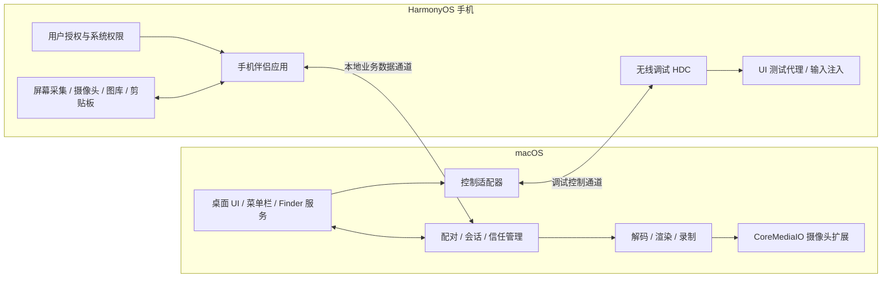
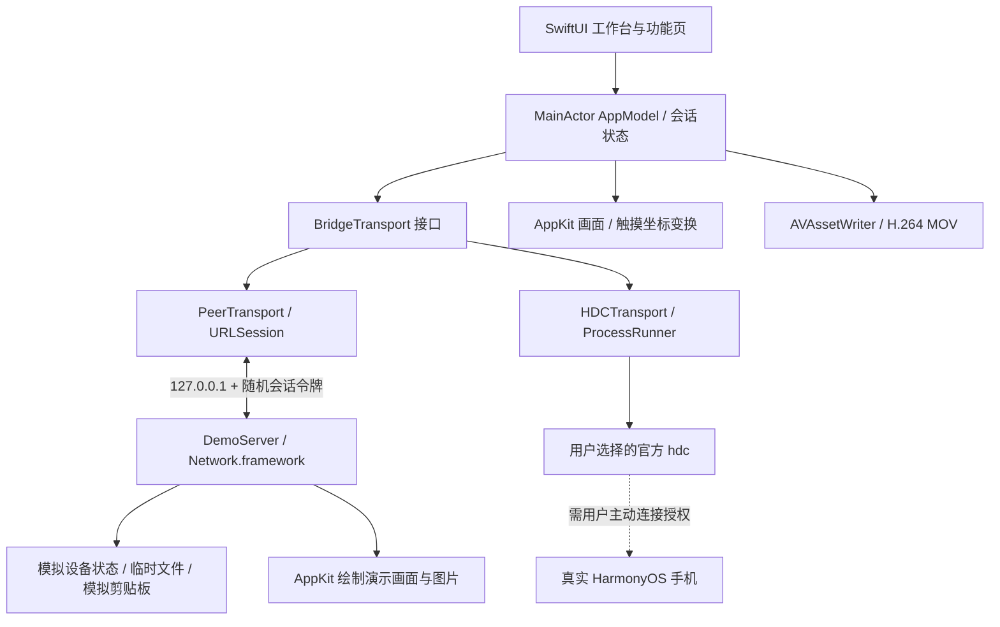

# 灵犀互联原理分析与鸿桥实现

核验日期：2026-10-24。分析对象：本机 `/Applications/Lynsi.app`，版本 3.2.0（20）。本轮没有连接、搜索、读取或操作手机。

## 1. 结论与证据边界

灵犀互联是跨设备协作软件，由 macOS 客户端、HarmonyOS 客户端和多个系统接入模块组成。不能只写一个 Mac 窗口便获得手机的录屏、图库、剪贴板和摄像头权限。

本次使用三类证据：

| 类型 | 证据 | 可以得出的结论 |
| --- | --- | --- |
| 本地直接观察 | Info.plist、资源目录、RemoteControl.json、动态库依赖、摄像头扩展元数据 | 版本、系统要求、Bonjour 服务名、权限说明、捆绑 HDC 与 UI 测试代理、CMIO 扩展、框架依赖 |
| 开发者公开说明 | 产品说明、使用教程、隐私政策、App Store 页面 | 配对步骤、用户可见能力、无线调试要求、USB 支持范围、控制条件 |
| 工程推断 | 结合上述证据及平台公开 API 的设计解释 | 合理的实现路线，而不是对原应用源码的还原 |

没有解密 App Store 可执行文件，没有反编译或复用专有代码，没有提取配对令牌或认证数据，没有捕获设备通信。没有确认原应用线上报文格式、内部类名、线程结构、具体屏幕编码格式及加密握手细节。框架存在不能证明某条调用链一定使用它。

本地观察记录位于 `docs/installed-app-observations.json`；其中的哈希值来自应用自己的公开资源清单，不是本次对代理库执行哈希得到的校验结论。

## 2. 总体架构

图中是依据证据整理的功能架构，不是原应用源代码结构图。

### 2.1 配对与设备发现

本地 Info.plist 声明 Bonjour 服务 `_harmonyhandoff._tcp`。蓝牙权限文案提及设备发现与把 Mac 配成手机蓝牙键盘。它还声明本地网络权限和 Finder 的发送文件、发送文字服务。这些是直接观察。

开发者说明称首次扫码交换地址、配对信息和设备证书，并把连接固定到已配对设备；无需注册云账号。合理实现是：Bonjour / 蓝牙辅助发现 → 人工确认的二维码首次配对 → 设备身份保存 → 后续连接校验证书与会话。具体是否 TLS、TLS 的版本、报文加密与密钥派生算法没有通过本轮分析确认。

二维码既可能含下载链接，也可能含配对凭据，两者不能混用。真正的配对二维码不能当作普通截图公开。

### 2.2 画面通道

手机伴侣在手机上取得系统录屏许可，采集画面，编码，再通过本地网络向 Mac 发送。Mac 进行解码、缩放、展示与录制。原应用链接 VideoToolbox、CoreMedia、CoreVideo、AVFoundation，因此采用原生媒体流水线是有依据的工程推断；不能据此断言其实际使用 H.264、H.265 或某个帧封装格式。

一个高性能独立实现可以采用：手机公开屏幕采集接口 + 硬件编码 H.264 → 有界发送队列 → TLS 数据通道 → VideoToolbox 解码 → CVPixelBuffer / 原生视图。帧队列必须丢弃过时帧；输入命令不能被大文件传输阻塞；横竖屏变化应更新解码器、尺寸和触摸映射。音频需要独立处理，不能从“能够投屏”推断“能够转发声音”。

### 2.3 反向控制为什么要无线调试

原应用包含：

- `Contents/Helpers/hdc`
- `Contents/Helpers/libusb_shared.dylib`
- `RemoteControl.json`，其中 `architecture` 为 arm64、`networkOnlyUSB` 为 true
- 四个 `uitest_agent_v*.so`；资源清单把来源标记为 `xdevice-devicetest 6.1.0.210 (Apache-2.0)`

结合公开教程要求手机开启无线调试、信任 Mac，以及 Apple 芯片控制限制，可以确认它引入了调试控制能力。多版本代理意味着存在版本适配需求；具体选择规则与原生调用方式不能仅凭文件存在判断。

控制流水线通常是：Mac 鼠标坐标 → 去除画面黑边 → 映射到设备像素 → 归一化点击 / 长按 / 滑动事件 → 调试链路 → UI 测试能力。Mac 输入法组字与蓝牙 HID 键盘是两种不同方案。官方教程说明组字发送会覆盖手机剪贴板；这是该产品的行为，不代表所有输入实现都必须如此。

### 2.4 文件、相册、剪贴板

这些属于业务权限通道，而不是屏幕镜像的附赠功能：

- 文件：用户选择文件或授予目录访问，按块传输、流控、校验与原子落盘。
- 相册：手机侧通过系统照片权限或照片选择器提供资产列表、缩略图和按需原图。
- 剪贴板：手机与 Mac 分别使用各自平台剪贴板接口，需要主动读取 / 授权与回环抑制，避免无限互相同步。
- 删除相片：应有手机侧明确确认，不应把调试用户的文件删除能力当作图库权限。

HDC 的 `/data/local/tmp` 是调试目录，不等同于手机用户的“下载”。能用 `hdc file recv` 拉取该目录，不能证明能够访问完整图库或其他 App 数据。

### 2.5 USB、摄像头与系统集成

原应用包含 USB 库，但不能据此认为所有功能都支持 USB。开发者明确说明 USB 用于文件互传，控制功能要求局域网与无线调试。

`Contents/Library/SystemExtensions` 中存在独立的 CoreMediaIO 摄像头扩展，并声明专有 Mach 服务名。视频源进入桌面软件和注册成 FaceTime / Zoom 可选的系统摄像头，是两个层次。后者需要独立扩展目标、合适的签名与权限、主应用到扩展的 IPC 及用户启用流程。

## 3. 本次独立实现：鸿桥 Hongqiao

采用 Swift 6 工具链、Swift 5 语言模式、SwiftUI + AppKit，最低系统设为 macOS 14。本地构建为 Apple Silicon arm64；没有第三方 Swift 依赖，不需要 Python / Node 运行时。与原应用的 macOS 12 要求不同。

### 3.1 模块

| 模块 | 实现与职责 |
| --- | --- |
| HongqiaoCore | 传输协议、数据模型、远端参数转义、路径检查、画面坐标映射、进程超时、HDC 与 HTTP 客户端 |
| HongqiaoPeer | 真正通过本机 socket 提供服务的模拟设备，鉴权、画面、输入事件、文件和模拟剪贴板 |
| HongqiaoDesktop | SwiftUI 原生 UI、NSView 鼠标触摸映射、连接状态、用户主动的剪贴板读写、截图、录屏、文件保存与诊断 |
| Tests | 坐标与安全边界、真实 shell 引号验证、进程超时、假 HDC 命令验证 |

本地演示使用与 UI 分离的传输协议，文件是真的经过 HTTP 发送和取回，输入事件真的改变模拟状态；手机、相册、系统剪贴板均是显式模拟对象。并未把播放一个演示动画当作真实设备连接。

### 3.2 HDC 的已写实现

HDC 路径由用户选择，不探测或借用 Lynsi.app 内的工具。仅点击“发现设备”“连接此地址”“连接设备”等按钮才调用 HDC。

- `list targets`：发现已授权设备。
- `tconn IPv4:端口`：显式连接用户指定的无线调试地址，端口不写死。
- `param get`：读取连接目标的型号与版本。
- `snapshot_display -f ...` + `file recv`：读取帧；每会话使用独立临时路径。
- `uitest uiInput click / longClick / swipe / text / keyEvent`：注入操作。
- `ls -la` + `file send / recv`：访问调试用户有权限的文件目录。
- 断开时删除本会话产生的远端截图，不删除用户文件，不终止公共 HDC server。

这是可执行的真实后端代码，但本轮只以假 HDC 做参数和错误验证，没有手机实测。不保证鸿蒙 7 所有版本都开放对应命令。系统拒绝时界面显示错误并关闭控制，不静默假装成功。

### 3.3 会话与并发

UI 状态在 MainActor；HDC 子进程在后台队列，HTTP 使用 URLSession。单独的取帧任务不会无限并发排队；刷新时间按实际耗时计算。每个会话持有 generation 标识，旧连接结果不能更新新会话的帧画面。连续三次取帧失败后暂停并关闭输入。控制默认关闭，需用户手动开启。

录屏使用 AVAssetWriter 生成 H.264 MOV，单调递增时间戳，不含音频。当前实现保留录制起始画布尺寸，后续帧按比例缩放入画布。

### 3.4 本地会话安全与数据边界

- 模拟服务器仅绑定 `127.0.0.1`，随机分配端口，不面向局域网广播。
- 256 bit 系统随机令牌，每次新演示会话生成；请求须带 Bearer 令牌，不写日志。
- 仅接受固定路由；拒绝错误的长度、超大请求、不合法文件名和重复文件覆盖。
- 远端 shell 参数逐一做 POSIX 单引号转义；本地 Process 直接传参数，不经本地 shell 解释。
- 不自动读取系统剪贴板，不监视相册，不激活摄像头、蓝牙或系统扩展。
- 演示文件保存在唯一临时目录，结束会话后清理。单文件 16 MB；HDC 文件 256 MB，当前通过内存读取，尚未实现大文件分块流式传输。
- 没有开放明文 LAN 服务。未来手机伴侣接入必须先实现 TLS 与可信配对，不能简单把监听地址改成 `0.0.0.0`。
- 日志不主动保存输入文字或帧；外部工具返回的错误可能含远端路径，导出前应自行查看。

## 4. 功能对照与真实交付状态

| 能力 | 本地演示 | HDC 后端 | 与原应用的差距 |
| --- | --- | --- | --- |
| 原生 Mac 工作台 | 已实现 | 共用 UI | 仅 arm64、macOS 14+，本地临时签名 |
| 设备连接 | 本机 HTTP 演示服务 | USB / 指定地址无线调试 | HDC 未真机验证，无手机侧二维码配对 |
| 投屏 | 模拟画面真实网络取帧 | 设备截图轮询 | 未实现低延迟连续视频流和音频 |
| 点击 / 长按 / 滑动 / 返回 / 主页 | 已实现 | 命令后端已实现 | 手机兼容性待验证，没有直接复用原应用代理 |
| 中文输入 | 已实现 | `uitest uiInput text` | 部分版本与输入控件可能不支持，无蓝牙 HID |
| 文件双向传输 | 已实现、字节校验 | 调试目录发送 / 接收 | 无手机文件选择器、无分块与断点续传 |
| 双向系统剪贴板 | 模拟剪贴板 | 不支持，界面明确禁用 | 需独立手机 App 的系统 API 与授权 |
| 相册 | 程序绘制的示例图片 | 当前目录的可读图片 | 不等同于用户照片数据库权限 |
| 截图 / MOV 录屏 | 已实现 | 共用已有画面 | 无音频；帧率取决于后端 |
| 手机摄像头 → 系统摄像头 | 未实现 | 未实现 | 缺手机媒体源和签名 CMIO 系统扩展 |
| 自动重连 / 蓝牙唤醒 / Finder 服务 | 未实现 | 未实现 | 与原产品仍有明显差距 |

所以本次交付的准确名称是“独立可运行 Mac 原型 + 本地集成验证 + HDC 后端”，不是已完成全部手机能力的灵犀互联替代品。

## 5. 获得完整同功能体验还需完成的工程

1. 构建独立 HarmonyOS App（ArkTS + 必要的 C++ 媒体模块），由手机用户授予录屏、相册、文件、剪贴板和摄像头能力。需要 DevEco SDK、应用签名和设备适配。
2. 实现设备身份与 TLS 固定证书配对、Bonjour / mDNS 发现、信任撤销和重连；私钥放 Keychain，手机对应放系统安全存储。
3. 替换截图轮询为手机硬件编码与 Mac 原生解码；实现帧格式协商、旋转、网络背压、丢帧及重连关键帧。
4. 接入系统照片资产与文件选择器，形成真实用户权限边界；增加流式大文件传输、SHA-256 校验与原子提交。
5. 完成手机系统版本的 UITest 能力探测，验证中文、长按与滑动；按需要引入有清楚许可证与版本管理的独立开源代理。
6. 新建签名 CoreMediaIO 系统扩展，接通手机媒体源与主应用 IPC，验证 FaceTime / 会议软件可用性。
7. 完成真机矩阵、断连、锁屏、权限撤回、横竖屏、后台冻结、大文件和受保护画面测试。没有手机时不能把这些项判定通过。

## 6. 来源

- 灵犀互联产品说明：https://lynsi.app.mahui.me/
- 灵犀互联控制与输入教程：https://lynsi.app.mahui.me/support
- 灵犀互联隐私说明：https://lynsi.app.mahui.me/privacy
- Mac App Store 产品说明：https://apps.apple.com/cn/app/id6802585088
- 华为 HDC 使用指导：https://developer.huawei.com/consumer/cn/doc/harmonyos-guides/hdc
- 华为截图命令说明：https://developer.huawei.com/consumer/cn/doc/doccenter-deveco-studio/ide-hmos-screenshot
- 华为 UITest 指南：https://developer.huawei.com/consumer/cn/doc/harmonyos-guides/uitest-guidelines
- Apple Camera Extension：https://developer.apple.com/documentation/coremediaio/creating-a-camera-extension-with-core-media-i-o
- Apple VideoToolbox：https://developer.apple.com/documentation/videotoolbox

华为部分文档入口是动态页面，自动阅读结果可能为空；代码是否适用于具体鸿蒙版本，最终仍以对应 SDK 文档和真机命令响应为准。App Store 与产品官网存在版本更新时差，本轮安装包元数据与 App Store 的 3.2.0 为本机版本依据。
