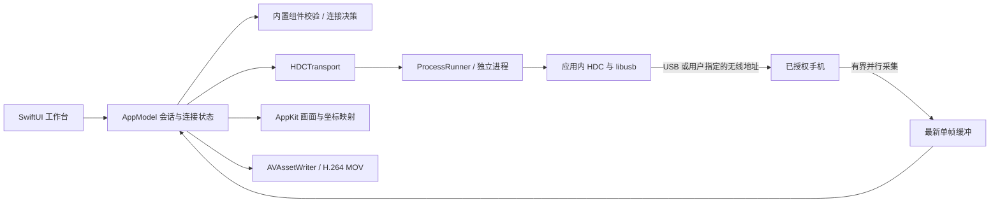

# 鸿桥架构与实现

版本 0.2.1，更新日期 2026-10-30。

## 产品结构

鸿桥是独立的原生 macOS 手机工作台。界面使用 SwiftUI 与 AppKit，设备连接使用随应用打包的 OpenHarmony HDC 和 USB 动态库。用户不需要安装 SDK、输入工具路径或操作命令行。

## 用户连接流程

数据线为默认连接方式。用户连接数据线，在手机开启 USB 调试并允许这台 Mac 连接后，点击“连接手机”。应用查找已授权设备：

- 没有设备：提示检查数据线、USB 调试与手机解锁状态。
- 有待授权设备：提示在手机确认授权后重试。
- 只有一台已授权设备：自动连接并进入投屏。
- 多台设备：要求选择，避免误连其他手机。

无线方式单独提供 IP 与端口两个输入框，说明它们来自手机当前的无线调试页面，不写死端口。无线连接只选择用户指定的目标；数据线方式排除已知的 IP:端口目标。应用不会在启动时自动搜索或连接手机。

手机的开发者选项、调试开关和首次信任确认必须由用户在手机完成。内置工具能消除 Mac 端的安装和路径配置，不能取消手机系统的授权要求。

## 内置组件与打包

HDC 3.2.0e、libusb 1.0.28 来自 OpenHarmony 官方 SDK 26.0.0.25（OpenHarmony 7.0 Beta1）。本次下载核对了官方 SDK SHA-256，并固定 toolchains ZIP 和原始文件的哈希。

源码目录 `Vendor/HDC` 保存原始组件与来源清单。应用内组件位于 `Contents/Helpers`。构建时先验证原始哈希，签名帮助工具与动态库，再生成包内的 `manifest.json`，最后签名完整应用。包内哈希与上游原始哈希分别保存。

应用启动只做本地组件完整性校验，不启动 HDC 设备发现。校验失败显示重新安装完整应用的提示，不要求用户寻找开发工具。

USB 库通过动态链接加载；随应用附对应发行标签的源码、补丁、构建文件和许可证，允许用户修改后重新构建和签名。完整归属见开源组件说明。

## 会话与控制

`HongqiaoCore` 提供模型、连接决策、参数校验、子进程执行与 `BridgeTransport` 接口；`HongqiaoDesktop` 提供工作台、连接帮助、画面、输入、文件与录屏界面。

- HDCTransport 使用 actor 管理会话；USB 最多四个生产任务、无线最多两个任务，每路依次截图与取回，使用独立文件避免覆盖。首帧取得原生尺寸，后续预览短边缩小至 720 像素。
- LatestFrameBuffer 只保留最新帧，并按采集开始时间丢弃迟到帧，避免画面倒退和积压。界面通过实际发布帧的时间计算帧率。
- 会话 generation 防止旧连接的异步结果更新新画面。
- 文件刷新使用独立请求标识，避免切换目录后显示旧列表。
- 鼠标坐标先去除画面黑边，再映射至手机原始像素，而不是缩小后的预览像素。
- 反向控制默认关闭；暂停与断开状态不注入操作。
- 连续取帧失败后暂停并关闭控制，界面显示失败状态。
- 暂停时生产任务停止发起新采集，恢复时丢弃暂停前开始的帧。短暂取帧失败后仍可继续恢复。
- 停止会话先取消生产任务、唤醒等待取帧的消费者，再清理本会话截图；不结束公共设备连接服务。

控制命令通过显式 FIFO gate 串行处理，避免 actor 在等待子进程期间重入造成 UITest 并发冲突。完整的成功行 `No Error` 会被正确识别；其他输出和退出状态共同判断失败类型。真实授权拒绝或设备断开会关闭控制，服务忙及单次操作错误只更新状态，不自动重放动作。

HDC 通过直接创建进程执行。本地不使用 shell 展开用户参数；设备 shell 参数逐一按 POSIX 规则转义。命令设有超时。文字输入失败不保留可能含输入内容的命令返回正文。

## 文件与媒体边界

当前画面使用 `snapshot_display` 截图轮询，不是硬件编码连续视频流。录屏通过 AVAssetWriter 生成 H.264 MOV，没有音频。

文件读写只能访问手机允许调试用户访问的目录；`/data/local/tmp` 不是“下载”或完整照片库。完整图库、手机系统剪贴板与手机摄像头需要独立手机伴侣和对应系统权限，目前尚未实现。

## 验证范围

默认离线检查覆盖坐标、输入参数转义、设备发现结果解析、单设备自动连接与多设备选择、无线地址验证、内置组件损坏检测、命令超时、控制响应分类、最新帧与过期帧处理、取消等待和实际帧率计算。默认包内检查只查询 HDC 版本，不查找手机。应用启动、签名、包内动态库加载、界面渲染与内容清理分别核验。

本次在用户授权后，使用 CHZ-AL00、HarmonyOS 7.0.0.111 进行独立真机检查：连续控制、24 帧完整采集与传输、暂停后取得新帧。详情见交付报告；该结果仅覆盖测试机与所列能力。

本机截图命令仍耗时约半秒。尝试通过自编译采集助手与 UITest 扩展建立驻留采集时，系统加载返回 `Permission denied`；实验文件未进入产品。当前优化仍属于截图流水线，连续硬件编码视频和音频需要后续独立的手机端实现及系统授权。

## 官方资料

- HDC 使用指导：https://developer.huawei.com/consumer/cn/doc/harmonyos-guides/hdc
- 手机开发者选项：https://consumer.huawei.com/cn/support/content/zh-cn02842747/
- SDK 发行目录：https://repo.huaweicloud.com/openharmony/os/7.0-Beta1/
- OpenHarmony HDC 源码：https://gitcode.com/openharmony/developtools_hdc
- USB 动态库源码：https://gitcode.com/openharmony/third_party_libusb
